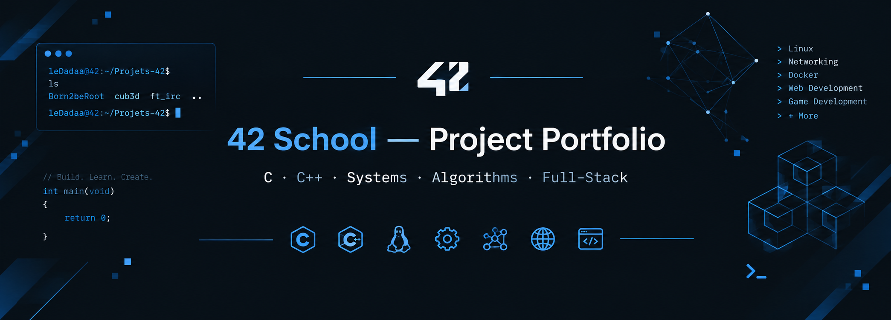

<div align="center">

**From C fundamentals to systems programming, networking and full-stack development.**

[](https://42.fr/)


[GitHub Profile](https://github.com/LeDadaa) · [Browse Projects](#project-index)

</div>

---

## About this repository

This repository brings together my projects completed during the **42 School core curriculum**. The projects explore low-level programming, algorithms, Unix systems, concurrency, computer graphics, networking, object-oriented programming, infrastructure and web development.

Each project directory contains its implementation. See the project index below to browse the source code.

## Featured projects

| Project | What it explores | Source |
|:--|:--|:--|
| **ft_transcendence** | Full-stack application architecture and web development | [Explore](./ft_transcendence/) |
| **cub3D** | Raycasting and rendering a 3D-like world in C | [Explore](./cub3d/) |
| **minishell** | Shell parsing, processes, pipes and redirections | [Explore](./minishell/) |
| **ft_irc** | Socket programming and the IRC protocol in C++ | [Explore](./ft_irc/) |

## Project index

### C foundations & communication

| Project | Focus | Code |
|:--|:--|:--|
| Libft | C standard-library functions, memory and linked lists | [Libft](./Libft/) |
| ft_printf | Variadic functions and formatted output | [ft_printf](./ft_printf/) |
| get_next_line | Buffered reading and file descriptors | [get_next_line](./get_next_line/) |
| minitalk | Interprocess communication using Unix signals | [minitalk](./minitalk/) |
| C Piscine Reloaded | C fundamentals and practice exercises | [C-piscine-reloaded](./C-piscine-reloaded/) |

### Algorithms & concurrency

| Project | Focus | Code |
|:--|:--|:--|
| push_swap | Sorting strategies and operation optimization | [push_swap](./push_swap/) |
| Philosophers | Threads, mutexes and synchronization | [Philosophers](./Philosophers/) |

### Unix systems & networking

| Project | Focus | Code |
|:--|:--|:--|
| Born2beRoot | Linux administration, virtualization and security | [Born2beRoot](./Born2beRoot/) |
| minishell | Unix shell implementation | [minishell](./minishell/) |
| NetPractice | IP addressing, subnetting and routing | [NetPractice](./NetPractice/) |
| ft_irc | IRC server and TCP socket programming | [ft_irc](./ft_irc/) |

### Graphics

| Project | Focus | Code |
|:--|:--|:--|
| so_long | 2D graphics, events and map handling | [so_long](./so_long/) |
| cub3D | Raycasting, textures and player movement | [cub3D](./cub3d/) |

### C++ & object-oriented programming

| Project | Focus | Code |
|:--|:--|:--|
| C++ Modules 00–09 | Classes, inheritance, polymorphism, templates and STL | [cpp](./cpp/) |

### Infrastructure & full-stack

| Project | Focus | Code |
|:--|:--|:--|
| Inception | Containerization and multi-service infrastructure | [Inception](./Inception/) |
| ft_transcendence | Full-stack application development | [ft_transcendence](./ft_transcendence/) |

## Technical areas

`C` · `C++` · `Unix / Linux` · `Algorithms` · `Concurrency` · `Networking` · `Computer Graphics` · `Docker` · `Web Development`

## Explore and run

Clone the repository:

```bash
git clone git@github.com:LeDadaa/Projets-42.git
cd Projets-42
```

Each project has its own structure, dependencies and build instructions. Check the project directory before compiling or running it. Some projects require a Linux environment or additional libraries to run properly.

---

<div align="center">

*Built during my journey through the 42 School core curriculum.*

[Back to top](#42-school--project-portfolio)

</div>
