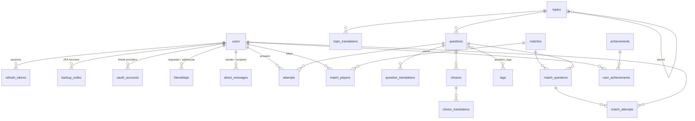

*This project has been created as part of the 42 curriculum by jverite, agalleze, dasamuel, damalca.*

# Maïa — practice for 42 exams, alone or together

## Description

**Maïa** is a web platform where 42 students prepare for their exams (Exam Rank 02 to 06). Instead of re-reading subjects, students **explain concepts in their own words** and get feedback, then test themselves against friends in **real-time multiplayer quizzes**.

The goal is to make exam preparation active and social: write an answer, have it graded by a language model, see what was missing, try again, and challenge other students live.

### Key features

- **Exercises by exam rank and level**: 127 written-answer questions across 5 exam ranks and 11 levels, each available in English, French and Spanish. Each one also carries four answer choices, so the same questions feed the multiplayer quiz.
- **AI grading**: a written answer is graded by a local LLM (Ollama) into *correct / imprecise / off target*. The verdict comes first, then an explanation streamed live. Prompt-injection attempts are detected and never accepted. When the model is unavailable, the student grades themselves against the reference explanation.
- **Timed training sessions**: a set of exercises against the clock, with a recap at the end.
- **Real-time multiplayer quiz**: rooms of 2 to 8 players joined with a code, 10 questions, 20 seconds each, live standings, speed bonus, winner screen. The server owns the clock and the score, and the correct answer never reaches the browser. A player who drops out has 60 seconds to come back and is then resynchronised to the current question.
- **Social**: user profiles, friends (requests, accept, remove, block), online presence, and one-to-one chat with typing indicators and read receipts.
- **Accounts and security**: email/password sign-up with strong-password rules and terms acceptance, sign-in with GitHub, Google or 42 (OAuth 2.0), two-factor authentication (TOTP with backup codes), avatar upload.
- **Progression**: XP and levels, a daily streak and achievements, with a progress bar on the dashboard and a notification when an achievement unlocks.
- **3 languages** (fr/en/es) with a language switcher, and dark and light themes.
- **Privacy Policy** and **Terms of Service**, linked from the footer of every page.

---

## Instructions

### Prerequisites

| Tool | Version | Why |
|---|---|---|
| Docker Engine + Docker Compose v2 (or Podman + podman-compose) | Compose v2.20+ | Runs the whole stack |
| GNU Make | any | Single entry point |
| OpenSSL | any | Generates the Postgres password on first run |
| Python 3 | any | Only to generate the Fernet key below |

Ports: the application is published on **8443** (HTTPS only).

### 1. Configure the environment

```bash
git clone <repository-url> transcendence && cd transcendence
cp srcs/.env.example srcs/.env
```

Then fill in the two mandatory keys in `srcs/.env`:

```bash
# SECRET_KEY — signs the session tokens (at least 32 characters)
openssl rand -hex 32

# TOTP_ENCRYPTION_KEY — encrypts 2FA secrets at rest (must be a Fernet key, 44 characters)
python3 -c "import base64,os;print(base64.urlsafe_b64encode(os.urandom(32)).decode())"
```

Every other variable has a working default and is documented in [`srcs/.env.example`](srcs/.env.example). The database credentials are **not** in `.env`: `make` creates them as Docker secrets in `secrets/` (git-ignored) on the first run.

**Optional features:**

- **OAuth (GitHub / Google / 42)**: set `<PROVIDER>_CLIENT_ID` and `<PROVIDER>_CLIENT_SECRET`. The callback URL to declare at the provider is `https://localhost:8443/api/v1/auth/oauth/<github|google|fortytwo>/callback`. An unconfigured provider sends the user back to the login page with an error message.
- **LLM grading**: set `LLM_ENABLED=true`, `LLM_BASE_URL` and `LLM_MODEL` (see below), and put a Tailscale auth key in `secrets/TS_AUTHKEY`. `make` then also starts the `tailscale` container. Without it, grading falls back to self-assessment and the rest of the app is unaffected.

### 2. Run

```bash
make            # builds and starts db, api and web in the background
```

Open **https://localhost:8443** and accept the self-signed certificate. On first start, the API applies the database migrations and loads the exercise content (`SEED_DEMO_DATA=true`).

| Command | Effect |
|---|---|
| `make` / `make up` | Build and start (production images) |
| `make dev` | Development mode: hot reload for the API and for Nuxt, behind the same nginx |
| `make logs` / `make ps` | Follow the logs / list the containers |
| `make down` | Stop the containers |
| `make clean` | Stop and **delete the volumes** (database, avatars, certificates) |
| `make re` | Full rebuild from scratch |

> **SELinux hosts (Fedora/RHEL):** the Makefile relabels the secret files automatically. **42 school machines (rootless Podman):** the stack publishes 8443 rather than 443, and the Makefile falls back to UID 1000 when the LDAP UID is out of range.

### Tests

The backend has a pytest suite (`srcs/backend/tests/`: auth, 2FA, roles, i18n, friends, chat, content loader, LLM grading, attempts, multiplayer over WebSocket). It needs the dev dependencies and a reachable PostgreSQL (see [`srcs/backend/BACKEND.md`](srcs/backend/BACKEND.md)). The front end runs `pnpm lint` and `pnpm typecheck` from `srcs/frontend`.

---

## Team Information

| Login | Role(s) | Responsibilities |
|---|---|---|
| **jverite** | Product Owner · Developer | Defines the product vision (exam practice with AI feedback plus a social quiz), prioritises the backlog and validates features. Also built the exercise content pipeline, the LLM grading and the exercise and training screens. |
| **agalleze** | Project Manager · Developer | Organises the team: task split, branches and pull requests, deadlines. Also built the authentication pages, profile and settings, the friends system and OAuth 2.0. |
| **dasamuel** | Technical Lead · Developer | Owns the architecture and the technical choices, and reviews critical changes. Also built the WebSocket layer, the chat, security hardening (password policy, terms acceptance) and the legal pages. |
| **damalca** | Developer | Built the real-time multiplayer game engine: rooms, server-side timer, scoring, disconnection grace period and reconnection. |

## Project Management

- **Work split by feature and module**: each module (WebSocket, chat, user management, exercises and LLM, game engine, multiplayer front end) lived on its own branch and was merged into `main` through a **GitHub pull request** (PRs #1 to #6).
- **Planning lived in the repository**: [`PLAN.md`](PLAN.md) is the roadmap, [`MODULES.md`](MODULES.md) records which modules are actually done and verified, [`srcs/backend/BACKEND.md`](srcs/backend/BACKEND.md) and [`srcs/frontend/FRONTEND.md`](srcs/frontend/FRONTEND.md) document the conventions and the protocols (REST, WebSocket messages, LLM grading) so that everyone can work on any part.
- **Tools**: Git and GitHub (branches, pull requests, reviews), shared Markdown documents in the repository.
- **Communication**: **TODO — Discord / Slack / meetings at school: to be completed by the team.**

---

## Technical Stack

| Layer | Technology | Why |
|---|---|---|
| Frontend | **Nuxt 4** (Vue 3, TypeScript) as a static SPA | File-based routing, auto-imported components, a strong ecosystem (i18n, color mode, icons). Built with `nuxt generate` and served by nginx, so no Node server is needed in production. |
| Styling | **Tailwind CSS 4** + our own design tokens ([`maia.token.css`](srcs/frontend/app/assets/css/maia.token.css)) | Utility classes for fast iteration; the tokens (colours, radii, shadows, motion) keep light and dark themes consistent. |
| i18n | `@nuxtjs/i18n` (front end), a locale resolver plus translation tables (back end) | Interface **and** content are translated into fr/en/es. |
| Backend | **FastAPI** (Python 3.14, async) | Native async for WebSockets and LLM streaming, Pydantic validation on every input, OpenAPI docs generated automatically (`/api/docs`). |
| ORM / migrations | **SQLAlchemy 2** (async, asyncpg) + **Alembic** | Typed models, versioned schema changes (14 migrations). |
| Database | **PostgreSQL 17** | Relational data with real constraints (unique pairs, CHECKs, cascades), `CITEXT` for case-insensitive emails and usernames, `JSONB` for grader metadata, full-text search with trigram indexes. |
| Real time | WebSocket (`/api/ws`) through nginx | Presence, chat signals and multiplayer rooms over one socket per tab. |
| AI | **Ollama** running `gemma4:12b` on a team member's GPU, reached through **Tailscale** | Local model: no answer is sent to a third-party AI provider, and there is no per-call cost. The model was chosen after benchmarking several (see `BACKEND.md`). |
| Security | Argon2id (pwdlib), PyJWT, Fernet, pyotp, Pillow | Password hashing, session tokens, encrypted TOTP secrets, image re-encoding. |
| Infrastructure | Docker Compose, **nginx** (TLS termination, reverse proxy, static files), Docker secrets | One command to run; HTTPS only; database credentials never in environment variables. |

**Main design choices**

- **Cookie-based sessions**: a short-lived JWT access token (15 min, `HttpOnly`), an opaque refresh token rotated on every use with **reuse detection** (a replayed token revokes the whole session family), and a **double-submit CSRF** token.
- **One API process**: presence, multiplayer rooms and rate limiters live in memory. This keeps the stack simple (no Redis). The trade-off is that a restart ends the matches in progress.
- **Content as code**: questions are versioned TOML files reviewed in pull requests and loaded at startup, rather than an in-app editor.

---

## Database Schema



| Table | Key fields | Notes |
|---|---|---|
| `users` | `id`, `email` (CITEXT, unique), `display_name` (CITEXT, unique), `password_hash` (Argon2id, NULL for OAuth-only accounts), `avatar_path`, `bio`, `locale`, `role`, `totp_secret_enc`, `totp_enabled`, `terms_accepted_at`, `last_seen_at`, `xp`, `current_streak`, `last_activity_date` | `role` is a CHECK-constrained enum (guest → admin) |
| `refresh_tokens` | `token_hash` (SHA-256, unique), `family_id` (UUID), `expires_at`, `revoked_at`, `user_agent`, `ip` | Rotation and reuse detection |
| `backup_codes` | `user_id`, `code_hash` (Argon2), `used_at` | Single-use 2FA recovery codes |
| `oauth_accounts` | `user_id`, `provider` (google / github / fortytwo), `provider_account_id` | Links an external identity to a user |
| `friendships` | `requester_id`, `addressee_id`, `status` (pending / accepted / blocked), `responded_at` | One row per **unordered** pair (unique index on `LEAST/GREATEST`), CHECK `requester <> addressee` |
| `direct_messages` | `sender_id`, `recipient_id`, `body` (≤ 2000), `created_at`, `read_at` | Indexed by conversation pair and by unread messages |
| `topics` / `topic_translations` | `slug`, `parent_id`, `position` / `locale`, `name`, `description` | Exam → level → exercise hierarchy |
| `questions` / `question_translations` | `slug`, `topic_id`, `kind` (single_choice / multi_choice / free_text), `key_points` (array), `difficulty_rating`, `status` / `locale`, `title`, `stem`, `explanation`, `search_vector` | Full-text search on the translations |
| `choices` / `choice_translations` | `question_id`, `position`, `is_correct` / `locale`, `text` | Multiple-choice answers |
| `tags`, `question_tags` | `slug` | Many-to-many |
| `attempts` | `user_id`, `question_id`, `raw_response`, `is_correct`, `grader` (llm / self_assessed / deterministic), `grader_meta` (JSONB), `created_at` | One row per graded answer; also used for the 3-attempts-per-24h limit |
| `matches` | `public_id` (room code), `mode` (duel / arena), `status`, `max_players`, `question_count`, `started_at`, `finished_at` | One row per multiplayer game |
| `match_players` | (`match_id`, `user_id`) PK, `score`, `final_rank` | |
| `match_questions` / `match_attempts` | `position`, `started_at` / `choice_id`, `is_correct`, `response_ms`, `score` | Full replay of every game |
| `achievements` / `user_achievements` | `code`, `icon` / (`user_id`, `achievement_id`) PK, `earned_at` | Achievement catalog, and who unlocked what |

`learning_paths`, `learning_path_translations` and `path_modules` exist in the schema for future learning paths; no feature uses them yet.

---

## Features List

| Feature | Description | Member(s) |
|---|---|---|
| Sign-up / login / logout | Email and password with validation on both sides, strong-password rules, mandatory terms acceptance, rate limiting | agalleze, dasamuel, jverite |
| Sessions | HttpOnly cookies, silent refresh, token rotation and reuse detection, CSRF protection | jverite, dasamuel |
| OAuth 2.0 | GitHub, Google, 42; only verified emails are linked to an existing account | agalleze, jverite |
| 2FA | QR code setup, 10 backup codes, verification at login, disabling | agalleze, dasamuel |
| Profile and settings | Edit display name, bio and language; avatar upload (re-encoded to WebP) with a generated default avatar | agalleze, dasamuel |
| Friends | Search users, requests, accept, remove, block; online status | agalleze, dasamuel |
| Chat | One-to-one messages in real time, history with pagination, unread badges, read receipts, typing indicator | dasamuel |
| Real-time layer | One WebSocket per tab: presence broadcast to friends, ping/pong, automatic reconnection with backoff | dasamuel, damalca |
| Exercises | Browse by exam, level and exercise; written answers | jverite |
| AI grading | Structured LLM verdict, streamed explanation, anti-injection vetoes, attempts limit, token budget, self-assessment fallback | jverite |
| Training sessions | Timed series of exercises with a recap | jverite |
| Multiplayer quiz (engine) | Rooms, ready check, server timer, scoring with speed bonus, forfeit, reconnection, persistence of every match | damalca |
| Multiplayer quiz (interface) | Create or join a room, lobby, rounds, live standings, result screen | dasamuel, damalca |
| Content | 127 questions with their answer choices in 3 languages, TOML files, loader with validation | jverite |
| Design system | Tokens, 15 reusable `Ui*` components, light and dark themes | jverite, agalleze, dasamuel |
| i18n | fr / en / es for interface and content | dasamuel, jverite, agalleze |
| Gamification | XP and levels, daily streak, achievements, dashboard progress bar, unlock notifications | agalleze |
| Legal pages | Privacy Policy and Terms of Service, linked in the footer | dasamuel |
| Infrastructure | Docker Compose, nginx TLS, Docker secrets, Makefile, Podman and SELinux support | jverite, agalleze, dasamuel |

---

## Modules

**Total claimed: 21 points** (8 Major × 2 + 5 Minor × 1). Required: 14.

| # | Module | Type | Pts | Member(s) |
|---|---|---|---|---|
| 1 | Use a framework for both the frontend and backend | Major | 2 | all |
| 2 | Real-time features using WebSockets | Major | 2 | dasamuel, damalca |
| 3 | Allow users to interact with other users (chat, profile, friends) | Major | 2 | dasamuel, agalleze |
| 4 | Standard user management and authentication | Major | 2 | agalleze, dasamuel |
| 5 | Complete LLM system interface | Major | 2 | jverite |
| 6 | Complete web-based game | Major | 2 | damalca, dasamuel |
| 7 | Remote players | Major | 2 | damalca |
| 8 | Multiplayer game (more than two players) | Major | 2 | damalca, dasamuel |
| 9 | Use an ORM for the database | Minor | 1 | jverite, agalleze |
| 10 | Support for multiple languages (3) | Minor | 1 | dasamuel, jverite |
| 11 | Custom-made design system (≥ 10 components) | Minor | 1 | jverite, agalleze, dasamuel |
| 12 | Complete 2FA system | Minor | 1 | agalleze, dasamuel |
| 13 | Remote authentication with OAuth 2.0 | Minor | 1 | agalleze, jverite |
| | **Total** | | **21** | |

### Justification and implementation

**1. Frameworks (Major).** Nuxt 4 on the front end and FastAPI on the back end. Nuxt gives routing, layouts, middleware and auto-imports; FastAPI gives async I/O (needed for WebSockets and LLM streaming) and typed validation. *Where:* [`srcs/frontend`](srcs/frontend), [`srcs/backend/app/main.py`](srcs/backend/app/main.py).

**2. WebSockets (Major).** The platform is social and live: presence, chat and games must update without reloading. One authenticated socket per tab (the cookie is checked at the handshake). Presence is sent only when the first tab opens and the last one closes. The client sends an application-level ping every 25 s and reconnects with exponential backoff and jitter. *Where:* [`api/ws.py`](srcs/backend/app/api/ws.py), [`services/realtime.py`](srcs/backend/app/services/realtime.py), [`useRealtime.ts`](srcs/frontend/app/composables/useRealtime.ts).

**3. User interaction (Major).** Studying together is the point of the platform. Chat: REST stores each message, then the WebSocket mirrors it to both sides, so a client that missed a frame rebuilds its state from the API. Profiles are public to signed-in users (never the email address). Friends: one row per pair, and blocking stops messages in both directions. *Where:* [`chat.py`](srcs/backend/app/api/v1/chat.py), [`friends.py`](srcs/backend/app/api/v1/friends.py), [`users.py`](srcs/backend/app/api/v1/users.py), [`messages.vue`](srcs/frontend/app/pages/messages.vue).

**4. Standard user management (Major).** Profile editing through a whitelist schema (a client cannot promote itself), and avatar upload with size cap, format check, decompression-bomb guard and re-encoding (which strips metadata and hidden payloads). When no avatar is uploaded, a generated identicon is used. Friends' online status and profile pages are also covered. *Where:* [`media.py`](srcs/backend/app/services/media.py), [`settings.vue`](srcs/frontend/app/pages/settings.vue), [`users/[id].vue`](srcs/frontend/app/pages/users/[id].vue).

**5. LLM interface (Major).** Written explanations are the core of exam preparation, and only a language model can grade free text. The grader asks the model for a structured verdict (JSON schema), and code-side vetoes reject any answer addressed to the grader or stating something false. Then:
- an explanation is **streamed** as NDJSON;
- errors are handled: an unreachable model, a timeout or malformed output switches to self-assessment;
- rate limiting applies: 3 graded answers per question per 24 h, a per-student bucket, and a shared hourly token budget.

*Where:* [`services/llm/`](srcs/backend/app/services/llm/), [`services/attempts.py`](srcs/backend/app/services/attempts.py), [`ExerciseGrader.vue`](srcs/frontend/app/components/exercise/ExerciseGrader.vue). *Requires* the model to be reachable (see Instructions).

**6. Web-based game (Major).** A live quiz duel or arena fits the platform better than an unrelated game: it reuses the exam content, and the subject lists quiz platforms as a valid game. Clear rules are shown in the lobby: 10 questions, 20 s each, 10 points per right answer plus a +5/+3/+1 speed bonus for the first three. The game ends with a ranking and a winner. *Where:* [`realtime.py`](srcs/backend/app/services/realtime.py), [`multiplayer.vue`](srcs/frontend/app/pages/multiplayer.vue).

**7. Remote players (Major).** Players are on separate machines, and the server is the only authority: it owns the timer and the score, never sends the correct answer, and refuses late, duplicate or foreign answers. On disconnection, the other players see the player as "reconnecting"; the player has a 60 s grace period, after which it counts as a forfeit. On reconnection, `match.state_sync` restores the current question, the remaining time and the standings. *Where:* [`ws.py`](srcs/backend/app/api/ws.py), [`useMultiplayer.ts`](srcs/frontend/app/composables/useMultiplayer.ts).

**8. Multiplayer, 3+ players (Major).** Rooms hold 2 to 8 players. The match starts when every player is ready, every player gets the same question at the same moment, and a question closes when everyone has answered or the timer runs out. *Where:* same files; covered by [`test_ws_multiplayer.py`](srcs/backend/tests/test_ws_multiplayer.py).

**9. ORM (Minor).** SQLAlchemy 2 (async), with 24 mapped tables and Alembic migrations. Uniqueness is enforced by the database rather than by "check then insert", to avoid race conditions. *Where:* [`app/models/`](srcs/backend/app/models/), [`migrations/`](srcs/backend/migrations/).

**10. Multiple languages (Minor).** fr, en and es, with 430 keys each, a switcher in the header and the sidebar, browser detection and a cookie. **The exercises themselves** are translated, with a fallback to English. *Where:* [`i18n/locales/`](srcs/frontend/i18n/locales/), [`app/i18n.py`](srcs/backend/app/i18n.py).

**11. Design system (Minor).** Our own tokens (palette, typography IBM Plex Sans / Mono, radii, shadows, motion), a Lucide icon set, and 15 reusable components: `UiButton`, `UiInput`, `UiTextarea`, `UiSelect`, `UiCard`, `UiCallout`, `UiTag`, `UiChip`, `UiAvatar`, `UiPresenceDot`, `UiProgress`, `UiStat`, `UiBreadcrumb`, `UiCodeText`, `UiToaster`. *Where:* [`components/ui/`](srcs/frontend/app/components/ui/), [`maia.token.css`](srcs/frontend/app/assets/css/maia.token.css).

**12. 2FA (Minor).** TOTP with a QR code; the secret is encrypted at rest with Fernet. Activation gives 10 single-use backup codes (hashed). Login with 2FA is a two-step flow: the password alone opens no session. 2FA can be disabled with password and code. *Where:* [`auth.py`](srcs/backend/app/api/v1/auth.py) `/2fa/*`, [`settings.vue`](srcs/frontend/app/pages/settings.vue), [`login.vue`](srcs/frontend/app/pages/login.vue).

**13. OAuth 2.0 (Minor).** Most users are 42 students, so signing in with 42 (and GitHub or Google) removes one more password. The flow uses a `state` cookie against CSRF, and an existing account is linked **only through an email verified by the provider**. *Where:* [`services/oauth.py`](srcs/backend/app/services/oauth.py), [`AuthProviders.vue`](srcs/frontend/app/components/auth/AuthProviders.vue). *Requires* provider keys in `.env`.

---

## Individual Contributions

### jverite — Product Owner, Developer
- **Content pipeline**: versioned TOML content, loader with validation, 127 questions in three languages, and the read-only question and topic API with search.
- **LLM grading** end to end: model benchmark, prompts, JSON verdict, code vetoes, NDJSON streaming, limits and budget, self-assessment fallback, and the Tailscale container to reach the GPU.
- **Front end**: exercise browsing (exam carousel, levels), the grader shown as a conversation, timed training sessions.
- **Infrastructure and docs**: Docker, Fernet key fix, roadmap ([`PLAN.md`](PLAN.md)), backend documentation, migration chain repairs.
- **Challenges**: some models flagged an injection correctly but still accepted the answer, so the final verdict is decided in code rather than trusted from the model. The team also had two unrelated Git histories to merge into one.

### agalleze — Project Manager, Developer
- Initial project skeleton; authentication pages (login, sign-up) connected to the API; profile and settings; friends management (requests, accept, decline, search from the profile page); avatar and username in the sidebar.
- Front-end validation of display name and password.
- **OAuth 2.0** backend logic for Google, GitHub and 42.
- **Challenges**: a provider without keys used to send users to the provider's own error page with no way back, so unconfigured providers now redirect to the login page with an error.

### dasamuel — Technical Lead, Developer
- **Real-time backend** (`ws.py`, `ConnectionHub`) and its front end (`useRealtime`, presence, connection status).
- **Chat module**, front and back: conversations, history, read receipts, typing, unread badges.
- User management front end (auth, profile, settings) and session refresh.
- Multiplayer front end: setup, lobby, rounds, standings, result.
- Security hardening: stricter password policy on both sides, mandatory terms acceptance (migration and API), Privacy Policy and Terms of Service pages and footer.
- **Challenges**: an access token that expired every 15 min logged users out, so a single-flight refresh on 401 was added. A dependency import (`ofetch`) did not resolve under pnpm's strict layout, so errors are now read by shape.

### damalca — Developer
- **Multiplayer game engine**: rooms and codes, joining, ready check, server-side 20 s timer, scoring, standings, end of match.
- **Disconnections**: grace period, forfeit, reconnection with state resynchronisation, room clean-up.
- Checks for games with two players and more, room visibility and details, persistence of matches.
- **Challenges**: one player's controls were being disabled by another player's actions, which was fixed by keying all state per player. The timer had to stay authoritative when answers and the deadline arrive at the same moment.

---

## Resources

### Documentation
- [FastAPI](https://fastapi.tiangolo.com/) · [SQLAlchemy 2.0](https://docs.sqlalchemy.org/en/20/) · [Alembic](https://alembic.sqlalchemy.org/) · [Pydantic](https://docs.pydantic.dev/)
- [Nuxt 4](https://nuxt.com/docs) · [Vue 3](https://vuejs.org/guide/) · [Tailwind CSS](https://tailwindcss.com/docs) · [@nuxtjs/i18n](https://i18n.nuxtjs.org/)
- [PostgreSQL full-text search](https://www.postgresql.org/docs/current/textsearch.html) · [pg_trgm](https://www.postgresql.org/docs/current/pgtrgm.html)
- [MDN — WebSocket API](https://developer.mozilla.org/docs/Web/API/WebSockets_API) · [RFC 6455](https://datatracker.ietf.org/doc/html/rfc6455)
- [OWASP Cheat Sheets](https://cheatsheetseries.owasp.org/): Password Storage, Session Management, CSRF Prevention, File Upload
- [RFC 6238 — TOTP](https://datatracker.ietf.org/doc/html/rfc6238) · [OAuth 2.0 (RFC 6749)](https://datatracker.ietf.org/doc/html/rfc6749) · [42 API](https://api.intra.42.fr/apidoc) · [GitHub OAuth apps](https://docs.github.com/apps/oauth-apps)
- [Ollama API](https://github.com/ollama/ollama/blob/main/docs/api.md) · [Tailscale userspace networking](https://tailscale.com/kb/1112/userspace-networking)
- [Docker Compose](https://docs.docker.com/compose/) · [nginx WebSocket proxying](https://nginx.org/en/docs/http/websocket.html)

### How AI was used
- **As a product feature**: an LLM (Ollama, `gemma4:12b`) grades students' written answers. Its output is never trusted blindly: a JSON schema constrains it, and code-side vetoes make the final decision.
- **As a development tool**: an AI coding assistant (Claude, via Claude Code) was used to:
  - explain unfamiliar libraries and errors (SQLAlchemy async, pnpm layout, Podman/SELinux);
  - review code and audit the project against the subject and the evaluation sheet (security tests, responsive and console checks);

  Every suggestion was read, tested and discussed within the team before being kept. Each member can explain the code they are credited with above.

---

## Known Limitations

- Presence, rooms and rate limiters live in memory in a single API process: restarting the API ends the matches in progress.
- The LLM grading needs the GPU machine to be reachable; otherwise students grade themselves.
- Game statistics are recorded for every match but not yet displayed (no match history page).
- Password reset is not available yet: the "forgotten password" page does not send anything.
- In a multiplayer room, every player gets the questions in the language of the player who created the room.
- The certificate is self-signed: the browser shows a warning on first visit.

## License

Educational project, 42 school. No license granted for reuse.
